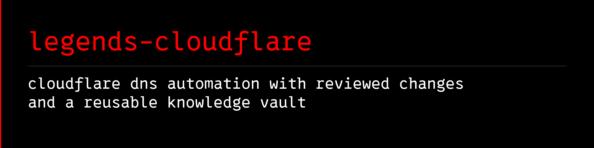

<a name="banner"></a>
<a name="legends-cloudflare"></a>

# 

[](https://github.com/avalonreset/legends-cloudflare/releases/latest)
[](https://github.com/avalonreset/legends-cloudflare/actions/workflows/checks.yml)
[](LICENSE)

**Cloudflare DNS automation with reviewed changes and a reusable knowledge vault.**

Use this Python **Cloudflare DNS CLI** with your agent to inspect zones and DNS records, preview changes, apply an explicitly confirmed change, and check the result. Keep the reasoning and operating history in Markdown that works with Obsidian and [legends-empire](https://github.com/avalonreset/legends-empire).

This is an independent community project built on the official Cloudflare API. Cloudflare provides the DNS platform. This module adds a bounded workflow, tested checks, and source-cited runbooks. It is not affiliated with or endorsed by Cloudflare.

## Why use this with an agent?

An agent can write an API request. The recurring work is deciding which zone and record it means, preserving existing settings, reviewing the exact change, checking what actually happened, and leaving enough context for the next session.

| Need | What this module supplies |
|---|---|
| Know what exists | Paginated zone and record inventories; incomplete results fail explicitly |
| Review before changing DNS | JSON preview with before-state, proposed fields, and a SHA-256 confirmation |
| Avoid broad accidental changes | One record per change; ambiguous matches fail; deletion requires an exact ID |
| Preserve settings | PATCH updates and preservation checks for fields you did not change |
| Verify the result | API readback after a write, with honest failure reporting |
| Reuse what you learn | Source ledger, DNS runbooks, migration checklist, and private receipt templates |
| Fit the existing ecosystem | One central `cto-legends` skill; module instructions loaded only when needed |

These checks reduce specific failure modes; they do not make DNS changes risk-free. API readback confirms provider state, not worldwide DNS propagation or application health.

## Install the Cloudflare DNS CLI

Python 3.11 or newer. No runtime dependencies or MCP server.

```sh
git clone https://github.com/avalonreset/legends-cloudflare.git
cd legends-cloudflare
python -m pip install .
legends-cloudflare doctor
```

Load `CLOUDFLARE_API_TOKEN` from your secret manager into the process environment. Use Zone Read and DNS Read for inspection, and DNS Edit only for approved writes, limited to the intended zones. The program does not discover `.env` files or accept tokens as command-line arguments.

```sh
legends-cloudflare doctor --live
legends-cloudflare zones
legends-cloudflare nameservers --zone example.com
legends-cloudflare records --zone example.com
```

Live doctor checks zone listing only. It does not prove DNS read or edit permissions. Record output can contain private DNS content; keep it outside public repositories and managed installations.

## Quick start: preview and update Cloudflare DNS records

```sh
legends-cloudflare upsert --zone example.com --name www --type A --content 192.0.2.10
```

This performs API reads and returns a plan without sending a write. Review the full before-state, payload, action and `sha256`. Use `@` for the zone apex, a single label such as `www`, or an in-zone fully qualified name.

Only after approving that plan, repeat the same command with its exact zone name and hash:

```sh
legends-cloudflare upsert --zone example.com --name www --type A --content 192.0.2.10 --apply --confirm-zone example.com --confirm-plan SHA256_FROM_PREVIEW
```

The command rebuilds the plan and refuses a changed hash. It also rechecks the record immediately before the write. Cloudflare does not supply an atomic compare-and-swap transaction here; a concurrent edit in the final read/write gap remains possible.

Omitted TTL, proxy and MX priority options preserve existing settings. New records default to automatic TTL and DNS-only; new MX records require `--priority`. Use `--proxied` or `--dns-only` explicitly to change proxy status.

Supported changes: **A, AAAA, CNAME, TXT, MX and NS**. Other types can appear in an unfiltered inventory, but cannot be changed by this release. Structured SRV and CAA records are deliberately excluded until their schemas and tests are implemented.

## Delete one reviewed record

Obtain its ID from `records`, then preview:

```sh
legends-cloudflare delete --zone example.com --name old --type A --record-id EXACT_RECORD_ID
```

Apply only with `--apply --confirm-zone example.com --confirm-plan SHA256_FROM_PREVIEW`. The program deletes that ID and checks that it is absent. It never deletes an entire matching record set.

## Knowledge vault and Empire

Start at [wiki/index.md](wiki/index.md) or attach the versioned knowledge pack at [knowledge/cloudflare/pack.json](knowledge/cloudflare/pack.json) (`legends.knowledge-pack/v1`). Open this repository folder in Obsidian or read it as plain Markdown. The source archive contains the vault; the wheel installs the CLI.

Use [the Empire integration guide](docs/EMPIRE.md) to keep private domain inventories, plans, receipts and incidents in an existing project. The module does not silently create vault records, migrate projects, or collect your infrastructure into a public repository.

## CTO Legends router

The module recipe is [docs/AGENT-RECIPE.md](docs/AGENT-RECIPE.md). The vendored `skills/cto-legends/SKILL.md` is an unchanged copy of the central router. Do not register a separate Cloudflare skill.

With the central [cto-legends](https://github.com/avalonreset/cto-legends) router:

```sh
cto-legends sync
cto-legends sync --apply
cto-legends install legends-cloudflare
cto-legends install legends-cloudflare --apply
cto-legends handoff legends-cloudflare
cto-legends run legends-cloudflare -- doctor
```

A module release is followed by a verified catalog entry with an immutable commit and archive checksum. Catalog sync makes it discoverable; installation remains explicit. The router skill text does not need to change.

## Architecture and project layout

```text
Operator / Agent
  -> legends-cloudflare CLI (zones, nameservers, records, upsert, delete)
  -> Plan builder (before-state snapshot + proposed payload + SHA-256 hash)
  -> Explicit confirmation (--apply --confirm-zone --confirm-plan)
  -> Cloudflare DNS API PATCH/POST/DELETE + immediate readback verification
```

- `legends_cloudflare/`: Zero-dependency Python CLI and Cloudflare DNS API v4 client.
- `wiki/` and `knowledge/cloudflare/`: Source-cited DNS runbooks, migration checklists, and attachable [`legends-empire`](https://github.com/avalonreset/legends-empire) knowledge pack.
- `docs/`: Agent recipe, Empire integration guide, release readiness, and [search strategy](docs/SEARCH-STRATEGY.md).

## FAQ

**Does `legends-cloudflare upsert` modify DNS records immediately?**
No. Running `upsert` or `delete` without `--apply` performs read-only API queries and returns a JSON preview containing the current record state, the proposed change, and a `sha256` plan hash. Changes are sent only when you repeat the command with `--apply`, `--confirm-zone`, and `--confirm-plan`.

**Which DNS record types can this module modify?**
This release supports reviewed changes for `A`, `AAAA`, `CNAME`, `TXT`, `MX`, and `NS` records, and preserves existing TTL and proxy settings when those flags are omitted.

## Boundaries and verification

This release does not transfer registrar ownership, change registrar nameservers, manage Workers, create tunnels, or automate bulk DNS imports. Use the linked [migration runbook](wiki/migration.md) and official provider tools for those tasks.

It calls the Cloudflare DNS API for this bounded workflow. It is not Cloudflare's Agents SDK, an AI-agent hosting platform, or a Cloudflare MCP server.

```sh
python -m unittest discover -s tests -v
python scripts/check_release.py
```

Exit codes: `0` completed inspection, preview or verified change; `1` operational failure; `2` invalid CLI syntax. A failed write or readback can mean remote state changed: inspect it before retrying. No automatic retry or rollback occurs.

See [compatibility and verification](docs/RELEASE-READINESS.md), [contributing](CONTRIBUTING.md), [security](SECURITY.md), and [attribution](THIRD_PARTY_NOTICES.md). MIT licensed.
