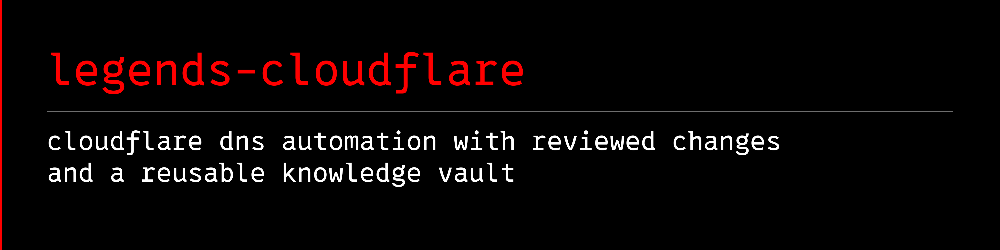
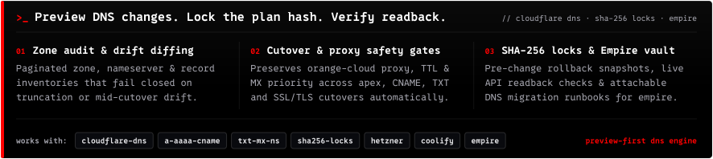
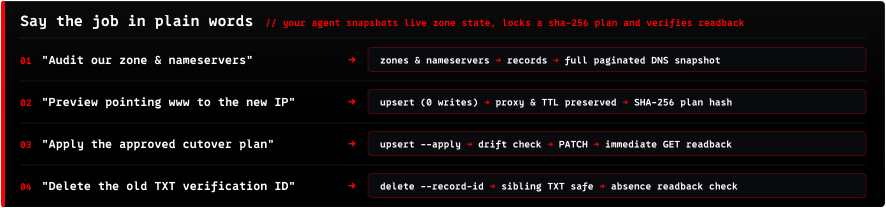
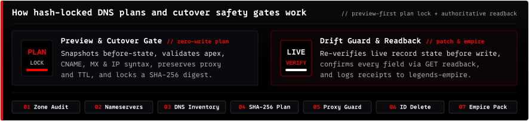
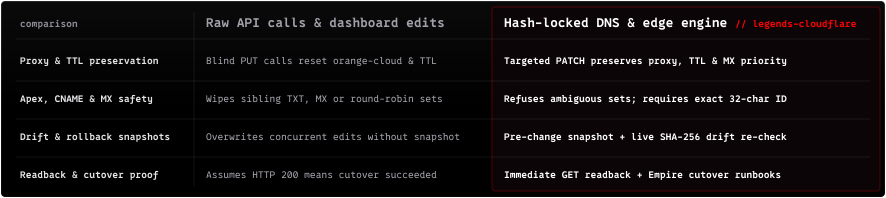

<a name="banner"></a>
<a name="legends-cloudflare"></a>

# 

[](https://github.com/avalonreset/legends-cloudflare/releases/latest)
[](https://github.com/avalonreset/legends-cloudflare/actions/workflows/checks.yml)
[](pyproject.toml)
[](legends_cloudflare/dns.py)
[](LICENSE)

**Zero-dependency Cloudflare DNS, cutover audit, and hash-locked record change CLI (`legends-cloudflare`) for coding agents: audit zones and assigned nameservers, snapshot complete paginated DNS inventories, preview single-record changes with automatic orange-cloud proxy and TTL preservation, enforce SHA-256 plan locks with immediate API readback, and attach source-cited DNS migration runbooks to [`legends-empire`](https://github.com/avalonreset/legends-empire).**


```text
Install or update legends-cloudflare via cto-legends (https://github.com/avalonreset/cto-legends): run `cto-legends install legends-cloudflare --apply`, then `cto-legends handoff legends-cloudflare` and follow the returned JSON recipe to verify `legends-cloudflare doctor`.
```



## Why `legends-cloudflare` exists

Letting an AI agent edit live Cloudflare DNS records with improvised `curl` calls or ad-hoc dashboard clicks is one of the fastest ways to take down production traffic or break domain email delivery:

1. **Silent orange-cloud proxy and custom TTL resets:** In Cloudflare's API, sending a naive replacement payload without carrying forward existing metadata routinely turns off orange-cloud edge proxying, exposes origin server IPs, or resets custom TTL and MX priority values.
2. **Accidental destruction of sibling TXT, MX, and round-robin records:** Production domains often hold multiple SPF/DKIM/ACME `TXT` verification entries, multiple `MX` mail servers, or round-robin `A` records on the same hostname. A script that filters by hostname and loops over matches can wipe out sibling records in seconds.
3. **Blind writes over concurrent zone drift:** Applying a DNS change from stale chat history without re-checking the live zone right before writing can overwrite an ACME certificate challenge or a teammate's hotfix, while assuming an HTTP response means worldwide cutover success hides broken authoritative state.

`legends-cloudflare` wraps the official Cloudflare DNS API in a **preview-first, hash-locked change engine** that pairs naturally with [`legends-hetzner`](https://github.com/avalonreset/legends-hetzner), [`legends-coolify`](https://github.com/avalonreset/legends-coolify), and [`legends-empire`](https://github.com/avalonreset/legends-empire). Every single-record change (`A`, `AAAA`, `CNAME`, `TXT`, `MX`, `NS`) begins as a zero-write preview that snapshots the live before-state, preserves unspecified proxy and TTL fields, and outputs a deterministic `sha256` plan hash. Nothing touches Cloudflare until you explicitly pass `--apply --confirm-zone <zone> --confirm-plan <sha256>`.

## Ask in plain english

Once [`cto-legends`](https://github.com/avalonreset/cto-legends) is installed, you ask your coding agent in plain english. It snapshots the zone inventory, builds a zero-write change plan with proxy and TTL preservation, waits for your confirmation, and verifies the live readback:



## Architecture: hash-locked DNS plans and cutover safety gates



### 1. Zone audit, nameserver inspection, and fail-closed pagination

Before planning any domain migration or server cutover, `legends-cloudflare` gives your agent a bounded, read-only inspection surface:

- **Fixed-origin HTTPS transport with redirect refusal (`legends_cloudflare/api.py`):** Every request is locked to `https://api.cloudflare.com/client/v4/zones...` with `ProxyHandler({})` and `NoRedirect` enforced so bearer tokens are never forwarded across HTTP redirects or ambient proxies. Raw provider error bodies are sanitized so secrets never leak into logs.
- **Complete paginated inventory with duplicate & truncation guards:** `zones` and `records` iterate across all API pages (`per_page=50`) and fail closed if `total_pages` metadata is truncated, if pagination ends early, or if a concurrent zone edit causes duplicate record IDs across pages.

### 2. Cutover safety gates, proxy preservation, and SHA-256 plan locks

Every subcommand in `legends-cloudflare` separates read-only discovery and zero-write plan generation from confirmed single-record writes:

| Surface | `legends-cloudflare` Subcommands | What It Does |
| :--- | :--- | :--- |
| **Runtime & Resource Checks** | `doctor`, `doctor --live`, `resources` | Offline Python 3.11+ readiness check (`doctor`), live zone-list token verification (`doctor --live`), and packaged recipe + knowledge-pack path resolution (`resources`). |
| **Zone & Nameserver Audit** | `zones`, `nameservers --zone <zone>` | Lists accessible zones (`id`, `name`, `status`, `name_servers`) and inspects assigned Cloudflare nameservers for registrar cutover planning. |
| **Paginated DNS Inventory** | `records --zone <zone> [--name <name>] [--type <type>]` | Returns complete, normalized DNS record snapshots (`id`, `type`, `name`, `content`, `ttl`, `proxied`, `priority`, `comment`, `tags`, `settings`, `modified_on`). |
| **Preview-First Record Upsert** | `upsert --zone <zone> --name <name> --type <type> --content <val>` | Validates IPv4/IPv6 and ASCII/punycode hostnames offline, preserves existing `proxied`, `ttl`, and `priority` settings when omitted, and returns a zero-write JSON plan (`writes_sent: 0`) with a `sha256` digest. |
| **Hash-Confirmed Cutover Write** | `upsert ... --apply --confirm-zone <zone> --confirm-plan <sha256>` | Re-fetches the live record before writing to refuse mid-cutover drift, executes a targeted `PATCH` or `POST`, and performs an immediate `GET` readback to verify every updated and preserved attribute. |
| **Exact-ID Guarded Delete** | `delete --zone <zone> --name <name> --type <type> --record-id <id>` | Refuses multi-record set deletion by requiring the exact 32-character hexadecimal `--record-id` for both preview and `--apply`, then confirms via readback that the target ID is absent while sibling records remain intact. |

### 3. Pre-change rollback snapshots, authoritative readback, and `legends-empire` vault pack

- **Pre-change rollback snapshots (`plan.before`):** Every `upsert` and `delete` plan embeds the full `before` snapshot (`id`, `type`, `name`, `content`, `ttl`, `proxied`, `priority`, `comment`, `tags`, `settings`, `modified_on`) alongside the proposed `payload` and `sha256` hash so operators have the exact pre-change state required to roll back a cutover.
- **Attachable [`legends-empire`](https://github.com/avalonreset/legends-empire) knowledge pack (`knowledge/cloudflare/pack.json`):** Ships with a `legends.knowledge-pack/v1` operational library and [wiki/index.md](wiki/index.md) covering least-privilege token scoping, full-zone DNS migrations, DNSSEC DS coordination, authoritative vs recursive lookup checks, and private change-receipt templates ([templates/change-receipt.md](templates/change-receipt.md)).

## Raw API calls vs `legends-cloudflare`



## Quick start

```sh
# 1. Verify offline runtime health and packaged knowledge resources
legends-cloudflare doctor
legends-cloudflare resources

# 2. Check live token reachability, accessible zones, and assigned nameservers
legends-cloudflare doctor --live
legends-cloudflare zones
legends-cloudflare nameservers --zone example.com
legends-cloudflare records --zone example.com

# 3. Preview a single-record DNS update (zero writes sent; preserves proxy & TTL)
legends-cloudflare upsert --zone example.com --name www --type A --content 192.0.2.10

# 4. Apply the reviewed plan using its exact zone name and SHA-256 preview hash
legends-cloudflare upsert --zone example.com --name www --type A --content 192.0.2.10 \
  --apply --confirm-zone example.com --confirm-plan SHA256_FROM_PREVIEW

# 5. Preview and apply an exact-ID record deletion (protects sibling TXT/MX records)
legends-cloudflare delete --zone example.com --name old --type A --record-id EXACT_32_CHAR_RECORD_ID
legends-cloudflare delete --zone example.com --name old --type A --record-id EXACT_32_CHAR_RECORD_ID \
  --apply --confirm-zone example.com --confirm-plan SHA256_FROM_PREVIEW
```

## Reference

<details>
<summary><strong>Knowledge vault, DNS migration runbooks, and <code>legends-empire</code> integration</strong></summary>

Start at [wiki/index.md](wiki/index.md) or attach the versioned knowledge pack at [knowledge/cloudflare/pack.json](knowledge/cloudflare/pack.json) (`legends.knowledge-pack/v1`). Open this repository folder in Obsidian or read it as plain Markdown.

- **Operational runbooks:** [Authentication & token scoping](wiki/authentication.md), [DNS operations & post-write checks](wiki/dns-operations.md), [DNS hosting migration & DNSSEC](wiki/migration.md), [Troubleshooting](wiki/troubleshooting.md), and the dated [source ledger](references/sources.md).
- **Private operating templates:** Use the [Empire integration guide](docs/EMPIRE.md) with [templates/domain-inventory.md](templates/domain-inventory.md), [templates/change-receipt.md](templates/change-receipt.md), and [templates/incident-review.md](templates/incident-review.md) to keep private domain inventories, rollback snapshots, and cutover receipts in your own vault outside public repositories.

</details>

<details>
<summary><strong>Agent setup (via <code>cto-legends</code>) and standalone installation</strong></summary>

### Agent setup (via `cto-legends`)

The module recipe is [docs/AGENT-RECIPE.md](docs/AGENT-RECIPE.md). The vendored [skills/cto-legends/SKILL.md](skills/cto-legends/SKILL.md) is an unchanged copy of the central [`cto-legends`](https://github.com/avalonreset/cto-legends) router. Do not register a separate Cloudflare skill.

Run `cto-legends handoff legends-cloudflare` to inspect the installed recipe and readiness checks, or run `cto-legends run legends-cloudflare -- doctor`. For a standalone checkout:

```sh
python -m pip install .
legends-cloudflare doctor
legends-cloudflare resources
```

Load `CLOUDFLARE_API_TOKEN` from your secret manager into the process environment (`Zone:Read` and `DNS:Read` for inspection; `DNS:Edit` only for approved writes on selected zones). The CLI never auto-loads `.env` files or accepts tokens as command-line arguments.

</details>

<details>
<summary><strong>Repository layout, verification, and scope boundaries</strong></summary>

```text
Operator / Agent
  -> legends-cloudflare CLI (doctor, resources, zones, nameservers, records, upsert, delete)
  -> Plan builder (before-state snapshot + proposed payload + SHA-256 digest, writes_sent=0)
  -> Explicit confirmation (--apply --confirm-zone --confirm-plan) + pre-write drift re-check
  -> Cloudflare DNS API PATCH/POST/DELETE + immediate GET readback verification
```

- `legends_cloudflare/`: Zero-dependency Python 3.11+ CLI (`cli.py`), hash-locked plan builder (`dns.py`), fixed-origin API client (`api.py`), and packaged resource resolver (`resources.py`).
- `wiki/` and `knowledge/cloudflare/`: Source-cited DNS runbooks, migration checklists, and attachable [`legends-empire`](https://github.com/avalonreset/legends-empire) knowledge pack.
- `docs/`: [Agent recipe](docs/AGENT-RECIPE.md), [Empire integration guide](docs/EMPIRE.md), [release readiness](docs/RELEASE-READINESS.md), [release protocol](docs/RELEASE.md), and [search strategy](docs/SEARCH-STRATEGY.md).

```sh
python -m unittest discover -s tests -v
python scripts/check_release.py
```

Supported record writes: `A`, `AAAA`, `CNAME`, `TXT`, `MX`, and `NS`. This module does not transfer registrar ownership, change registrar nameservers, deploy Cloudflare Workers, manage tunnels, or run unreviewed bulk DNS imports. Exit codes: `0` completed inspection, preview, or verified change; `1` operational failure; `2` invalid CLI syntax. A failed write or readback can mean remote state changed: inspect live zone state before retrying, as no automatic retry or blind rollback occurs.

</details>

## Contributing, security, and license

This is an independent community project built on the official Cloudflare API and is not affiliated with or endorsed by Cloudflare. See [CONTRIBUTING.md](CONTRIBUTING.md), [SUPPORT.md](SUPPORT.md), [PRIVACY.md](PRIVACY.md), [CODE_OF_CONDUCT.md](CODE_OF_CONDUCT.md), and [SECURITY.md](SECURITY.md).

MIT License. See [LICENSE](LICENSE), [NOTICE](NOTICE), and [THIRD_PARTY_NOTICES.md](THIRD_PARTY_NOTICES.md).

[](https://github.com/avalonreset/cto-legends/issues/new?title=Message%20for%20Avalon%20Reset&labels=message)

<p align="center"><a href="https://github.com/stars/avalonreset/lists/cto-legends"></a></p>

**Specification & benchmarks on cto-legends.com:**
- **Module specification & architecture matrix:** [cto-legends.com/modules/legends-cloudflare](https://cto-legends.com/modules/legends-cloudflare)
- **Related engineering dispatches:** [Railway vs Render: Fly.io vs Self-Hosted Coolify PaaS](https://cto-legends.com/blog?post=railway-vs-render-fly-io-coolify-paas) · [Hetzner vs AWS & DigitalOcean: Cloud Server Planning](https://cto-legends.com/blog?post=hetzner-vs-aws-digitalocean-cloud-server-planning) · [How to Build AI Agents: Production CLI & MCP Routing](https://cto-legends.com/blog?post=how-to-build-ai-agents-cli-mcp-routing)
- **Ecosystem hub:** [cto-legends.com/home](https://cto-legends.com/home)
